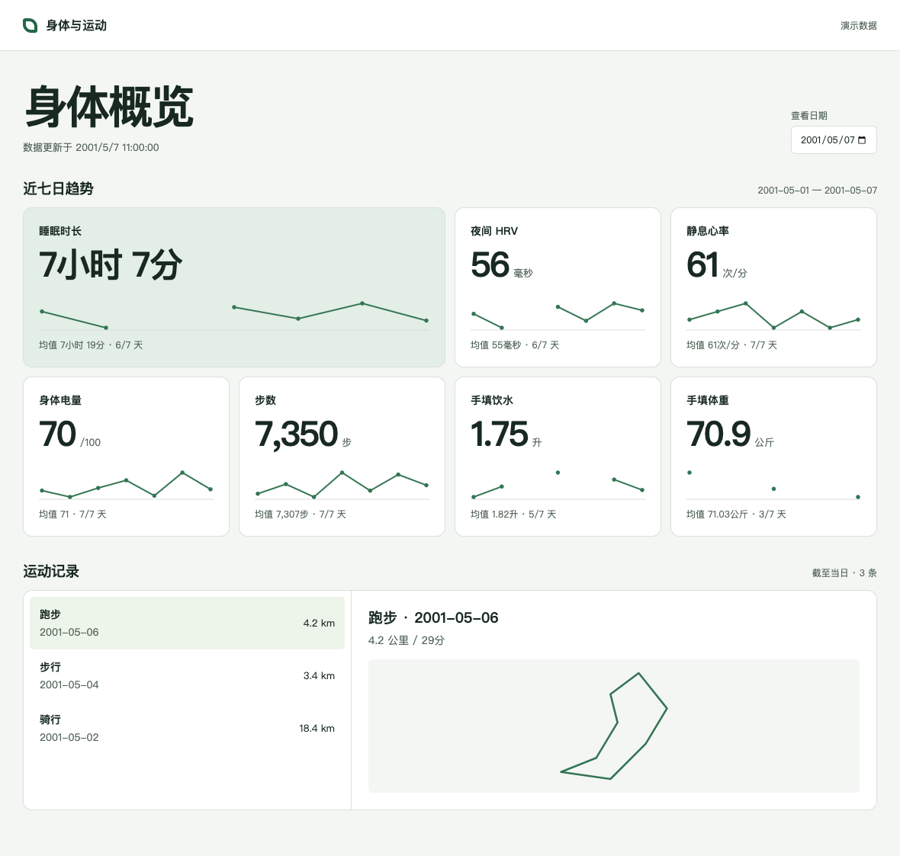

# Garmin Health and Activity Dashboard

[English](README.en.md) | [简体中文](README.md)

A local dashboard for the last seven days of sleep, overnight HRV, resting heart rate, Body Battery, steps, water intake, and body weight. Select an activity to view its distance, duration, and available GPS route. Charts and routes are drawn locally in your browser.



The dashboard interface and Excel sheet names currently use Simplified Chinese. This guide explains setup, account regions, and the workbook fields needed for manual entry.

## 1. Run the demo

Download and extract this repository's ZIP, or select **Use this template** on GitHub to create your own copy. Open a terminal in the project directory. The demo uses the Python standard library and requires Python 3.9 or later.

```sh
python3 serve.py
```

Open **http://127.0.0.1:8000/** in your browser. The **演示数据** label means “Demo data.” Use the date selector to explore different seven-day windows. Keep the terminal running while viewing the dashboard. Press Ctrl+C to stop the server. If port 8000 is occupied, run `python3 serve.py --port 8010` and open the corresponding address.

The dates, readings, activities, and route in `examples/overview.json` are fictional. After your first import or sync, the dashboard automatically reads `data/overview.json`. Refresh your browser to see the update.

## 2. Connect your Garmin account

The collector runs on macOS, Linux, and the NAS container described below. It requires Python 3.12 or later. Create a **Personal API Key** in your Garmin Connect web account settings, using the site for your account's region. The key grants access to your own records. [Garmin Personal API documentation](https://developer.garmin.com/gc-developer-program/personal/personal-api/) · [Official Python client](https://github.com/garmin/connect-personal-api-python)

Install the dependencies in a fresh project copy.

```sh
python3.12 -m venv .venv
.venv/bin/python -m pip install -r requirements-garmin.txt
mkdir -p secrets
chmod 700 secrets
(umask 077 && touch secrets/garmin-key)
chmod 600 secrets/garmin-key
```

Open `secrets/garmin-key` in a local text editor, paste your key, and save it as plain text. The commands below contain the file path only.

```sh
.venv/bin/python sync_garmin.py --region global --key-file secrets/garmin-key --latest-route
python3 serve.py
```

Use `--region global` for an international account or `--region cn` for a mainland China account. If the server is already running, refresh the page. The first sync requests the most recent seven calendar days. Later syncs start one day before the last successfully synced date to pick up delayed records. Activities are deduplicated by activity ID. Use a separate project copy or data directory for each account.

To backfill a specific period, supply a date range. This example requests January 2025. Actual coverage depends on the records available from your devices and the API. Omit `--latest-route` to skip downloading an activity's original file.

```sh
.venv/bin/python sync_garmin.py --region global --key-file secrets/garmin-key \
  --start 2025-01-01 --end 2025-01-31
```

Sleep follows the measurement date supplied by Garmin. Missing records and a measured zero step count are handled separately. Routes come from the latest activity's original FIT file, with gaps drawn as separate segments. Indoor activities may have no GPS track. A failed sync preserves the previous snapshot. If only the route download fails, the other health data can still be saved.

## 3. Schedule collection on a Synology NAS

The NAS runs the collector, and your computer's browser displays the dashboard. Install Container Manager with Docker Compose support, place the template in a private directory, and open that directory in a NAS terminal.

1. Use a regular NAS user with read/write access to this directory. Run `id -u` and `id -g` to find that user's UID and GID.
2. Run the commands below from a fresh project copy. If `.env` already exists, edit the relevant fields in that file. Enter your API key with a local text editor as described above. This example selects an international account and UTC. Before collecting data, set `GARMIN_TIMEZONE` in `.env` to your local IANA timezone, such as `Europe/London` or `America/New_York`, and use `GARMIN_REGION=cn` for a mainland China account.

```sh
umask 077
mkdir -p data secrets
touch secrets/garmin-key
chmod 600 secrets/garmin-key
test -f .env || printf 'COLLECTOR_UID=%s\nCOLLECTOR_GID=%s\nGARMIN_REGION=global\nGARMIN_TIMEZONE=UTC\n' "$(id -u)" "$(id -g)" > .env
```

After editing `.env` and the key file, build and run the collector.

```sh
docker compose build collector
docker compose run --rm --no-deps collector
```

3. Check that `data/overview.json` has been created. In DSM, open **Control Panel → Task Scheduler → Create → Scheduled Task → User-defined script**. Choose a schedule and an account with permission to run containers. The task should change to the project directory, then run the collector. Replace the example path with the actual location on your NAS.

```sh
cd '/replace/with/your/nas/template-directory' || exit 1
docker compose run --rm --no-deps collector
```

If DSM cannot find `docker`, run `command -v docker` in a working NAS terminal, then use that absolute path in the scheduled task. The collector writes to the private `data` directory and mounts the key file read-only. It runs once per invocation and publishes no container ports.

4. To view NAS data on your computer, use a private shared folder or Synology Drive to copy the generated **overview.json** into this project's **data/** directory on your computer. Then start `serve.py`. Choose one copy of the data as the authoritative file and apply manual entries there to avoid conflicting edits between devices. If you collect and view data on the same computer, you can skip the NAS setup.

## 4. Use Excel and enter water intake or weight

Install Excel support in the virtual environment created earlier. The demo page works without this dependency.

```sh
.venv/bin/python -m pip install -r requirements-excel.txt
mkdir -p exports
.venv/bin/python workbook.py template exports/health-log.xlsx
```

For manual entry from scratch, open the new workbook and use the **健康记录** sheet (“Health log”). Fill in these columns, keeping their original names so that the importer can recognize them.

| Workbook heading | Meaning |
| --- | --- |
| 日期 | Date, using an Excel date or `YYYY-MM-DD` |
| 手填饮水（升） | Manually entered water intake, in liters |
| 手填体重（公斤） | Manually entered body weight, in kilograms |

If you already have Garmin data, export a fresh workbook first. It includes a health log and separate sheets for activity types.

```sh
.venv/bin/python workbook.py export exports/latest-records.xlsx
# Fill in the water and weight columns in Excel, save, and close the workbook.
.venv/bin/python workbook.py import exports/latest-records.xlsx
```

If you filled in the blank template, import `exports/health-log.xlsx` instead. Import merges only water intake and weight by date. Blank cells preserve existing values, and importing the same file again does not add duplicate rows. If another device has already changed a manual value for the same date, export the latest version before editing again. Export preserves an existing output file by default, so choose a new filename when exporting another copy.

## Files, privacy, and licensing

| Path | Purpose |
| --- | --- |
| `site/`, `serve.py` | Local web interface and read-only preview server, with no build step |
| `examples/overview.json` | Fictional sample data distributed with the template |
| `sync_garmin.py` | Collect health summaries and activities through the official Personal API |
| `workbook.py` | Create personal Excel workbooks and import manual entries |
| `data/`, `secrets/`, `.env` | Your private data and configuration, created locally and excluded by Git ignore rules |

Save your workbooks in `exports/` or outside the repository. Imported JSON, GPS tracks, screenshots, and original activity files can contain personal information. When sharing a project, start from a clean copy with only the fictional data in `examples/`. Keep personal `data` directories off public static hosting. The preview server binds to the local loopback address. On a phone, `127.0.0.1` refers to the phone itself.

The template code is available under the [MIT license](LICENSE). This is an independent community project. Garmin products, services, and SDKs are subject to their respective official terms.
