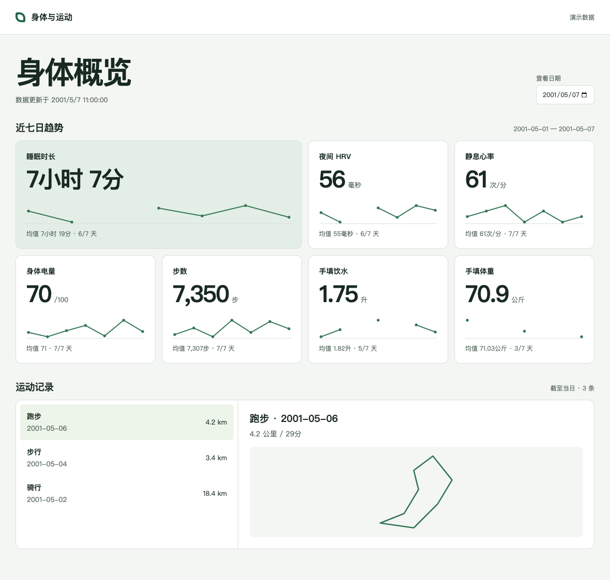

# Garmin 个人健康与运动看板

用一页查看最近七天的睡眠、夜间 HRV、静息心率、身体电量、步数、饮水量和体重。选中一次运动即可查看距离、用时和可用的 GPS 路线。看板在自己的电脑上运行，图表和轨迹均在浏览器本地绘制。



## 1. 两分钟打开演示

下载本仓库的 ZIP 并解压，或从 GitHub 选择 **Use this template** 创建自己的副本。在项目根目录打开终端。演示只用 Python 标准库，推荐 Python 3.9 或更新版本。

```sh
python3 serve.py
```

在浏览器打开 **http://127.0.0.1:8000/**。看到右上方的「演示数据」即已启动。切换日期可以回看不同的七天。终端保持运行，按 Ctrl+C 可停止服务。端口被占用时使用 `python3 serve.py --port 8010` 并打开对应地址。

演示来自 `examples/overview.json`，日期、读数、活动及折线路线均为虚构。首次导入自己的数据后，页面会自动改用 `data/overview.json`，刷新浏览器即可。无需将样本手动复制到 data 目录。

## 2. 接入自己的 Garmin 数据（可选）

适用于 macOS、Linux 和下面的 NAS 容器。准备 Python 3.12 或更新版本，在 Garmin Connect 网页端的账户设置中创建 **Personal API Key**。中国大陆和国际账户分别使用对应站点。个人密钥用于读取自己的记录。[佳明个人接口说明](https://developer.garmin.com/gc-developer-program/personal/personal-api/) · [官方 Python 客户端](https://github.com/garmin/connect-personal-api-python)

从干净的项目目录安装依赖：

```sh
python3.12 -m venv .venv
.venv/bin/python -m pip install -r requirements-garmin.txt
mkdir -p secrets
chmod 700 secrets
(umask 077 && touch secrets/garmin-key)
chmod 600 secrets/garmin-key
```

用本机文本编辑器打开 `secrets/garmin-key`，写入自己的密钥，保存为纯文本。下面的命令只包含文件路径，可直接在终端运行。

```sh
.venv/bin/python sync_garmin.py --region cn --key-file secrets/garmin-key --latest-route
python3 serve.py
```

国际账户把 `cn` 换成 `global`。如果服务已经打开，只需刷新网页。首次同步默认读取最近七个自然日。后续会从上次成功日期的前一天查到今天，以便接收延迟入库的数据。运动按活动 ID 去重。每个账户使用独立的项目副本或数据目录。

指定日期范围可以补历史，例如以下命令会请求 **2025 年 1 月**。实际覆盖取决于设备记录和接口返回。省略 `--latest-route` 可以跳过原始活动文件的下载。

```sh
.venv/bin/python sync_garmin.py --region cn --key-file secrets/garmin-key \
  --start 2025-01-01 --end 2025-01-31
```

睡眠按来源的测量日归属，零步和缺少记录分开显示。路线来自最近一次活动的原始 FIT 文件，有间断时分段绘制。室内运动可能没有 GPS。接口返回错误时会保留已有快照，可稍后重试；路线单独失败时其余健康数据仍可保存。

## 3. 在群晖 NAS 上定时采集（可选）

NAS 负责运行采集器，本机浏览器负责显示看板。安装支持 Docker Compose 的 Container Manager，将模板文件放到一个私有目录，再进入该目录。

1. 使用一个有权读写此目录的普通 NAS 用户。运行 `id -u` 和 `id -g` 取得它的 UID 与 GID。
2. 在项目根目录执行下面的命令生成本机配置。先确认这里是新副本；已有 .env 时请用编辑器修改相应字段。按上一节的方式用本机编辑器填写密钥。

```sh
umask 077
mkdir -p data secrets
touch secrets/garmin-key
chmod 600 secrets/garmin-key
test -f .env || printf 'COLLECTOR_UID=%s\nCOLLECTOR_GID=%s\nGARMIN_REGION=cn\nGARMIN_TIMEZONE=Asia/Shanghai\n' "$(id -u)" "$(id -g)" > .env
docker compose build collector
docker compose run --rm --no-deps collector
```

3. 确认 `data/overview.json` 已生成。在 DSM **控制面板 → 任务计划 → 新增 → 计划的任务 → 用户定义的脚本** 中，选定运行时间和具有容器运行权限的账户。脚本先切换到项目目录，再执行采集命令。将下面路径替换为自己的实际位置。

```sh
cd '/替换为NAS上的模板目录' || exit 1
docker compose run --rm --no-deps collector
```

DSM 定时任务找不到 `docker` 时，可在能正常执行的 NAS 终端中运行 `command -v docker`，将任务脚本的 `docker` 替换为该绝对路径。采集器只写私有 data 目录，密钥文件只读挂载。它按次运行，不发布任何容器端口。

4. 要在 Mac 看 NAS 的数据，可通过私有共享目录或 Synology Drive 将生成的 **overview.json** 同步到电脑上本项目的 **data/** 目录，再启动 `serve.py`。指定一份文件作为主数据，手工回填也在这份数据上完成，避免两个设备相互覆盖。同一台电脑上采集和查看时，可跳过整个 NAS 步骤。

## 4. 表格与手填数据

在上一节创建的虚拟环境中安装 Excel 支持。只使用演示网页时无需安装。

```sh
.venv/bin/python -m pip install -r requirements-excel.txt
mkdir -p exports
.venv/bin/python workbook.py template exports/健康记录.xlsx
```

从零手填时，在新表「健康记录」中输入日期及饮水量（升）、体重（公斤）。已有 Garmin 数据时，可先导出另一份最新工作簿；健康记录和各类运动会分表展示。

```sh
.venv/bin/python workbook.py export exports/最新记录.xlsx
# 在 Excel 中填写两项手填列、保存并关闭文件，再导入同一份文件
.venv/bin/python workbook.py import exports/最新记录.xlsx
```

如果填写的是空白模板，将最后一条命令的文件名改为 `exports/健康记录.xlsx`。导入仅合并饮水和体重，空白保留原值；重复导入不会增加重复行。若其他设备已经修改了同日的手填值，重新导出最新版本再编辑。导出默认保留已有同名文件，另选文件名即可。

## 文件与发布边界

| 路径 | 用途 |
| --- | --- |
| `site/`、`serve.py` | 无需构建的本地网页和只读预览服务 |
| `examples/overview.json` | 随模板分发的合成样本 |
| `sync_garmin.py` | 从官方 Personal API 采集健康摘要与活动 |
| `workbook.py` | 生成个人 Excel、回填手动记录 |
| `data/`、`secrets/`、`.env` | 使用者的私有数据与配置，由本机创建，已加入 Git 排除规则 |

请把自己的工作簿放在 `exports/` 或仓库外。导入后的 JSON、GPS 路线、截图和原始运动文件都可能包含个人信息；共享时请新建干净副本，仅使用 examples 中的演示数据。不要将个人 data 目录部署到公开静态站点。预览服务器默认绑定回环地址，手机上的 127.0.0.1 指向手机自身。

模板代码采用 [MIT 许可](LICENSE)。这是一个独立社区项目。Garmin 产品、服务和 SDK 各自适用其官方条款。
